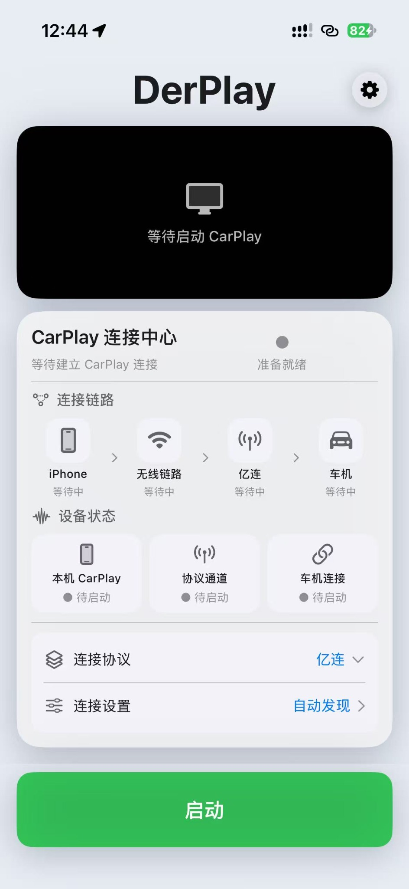

# DerPlay

**让 CarPlay 不再局限于原生 CarPlay 车机。**

  

DerPlay 是一款面向 iPhone 的通用无线车机互联工具。项目旨在让用户直接在 iPhone 上使用原生 CarPlay，并通过兼容的无线互联协议将画面输出至车机，无需将特定汽车品牌或车型作为使用前提。

> 当前处于早期开发阶段，Build 9 已完成部分真机功能验收；仍有实验功能和设备兼容性待验证。协议兼容性取决于设备、系统、认证条件及车机实现。

## 界面预览

  

首页设计参考图，非当前版本实机截图

## 功能特性

| 功能 / 互联方式 | 开发状态 | 说明 |
| --- | --- | --- |
| 本机 CarPlay | 已继承，待验证 | 本机显示、触控及全屏 |
| 无线百度 CarLife | 已继承，待验证 | 视频输出及触控回传 |
| 浏览器输出 | 已继承，待验证 | HTTP/HTTPS、视频、触控回传及可选 Wi-Fi 音频 |
| AirPlay | 实验功能，待验证 | 无线视频输出，手机端触控 |
| 无线亿连（EasyConnection） | 计划开发 | 独立协议适配 |
| 无线 ICCOA Carlink | 计划开发 | 目标为手机直接连接车机，不依赖中继 |
| 九号 4.3 寸仪表 | 已继承，待验证 | 上游尚未实物验证 |
| 九号 5 寸仪表 | 已继承，待验证 | 上游有单台出画反馈 |
| 九号 7 寸仪表 | 已继承，待验证 | 上游有单台出画反馈 |
| 台铃 4.3 寸仪表 | 已继承，待验证 | TL-DASH-V2，其他型号待验证 |
| 极核 AE4 MAX2+ 6.2 寸仪表 | 已继承，待验证 | 上游有单台出画反馈 |
| 极核 SE+ 5/5.5 寸仪表 | 已继承，待验证 | 按上报尺寸协商，上游尚缺全面实测 |
| 极核 AE2 Pro 5 寸仪表 | 已继承，待验证 | 上游有贡献者单台出画反馈 |
| 春风 5 寸仪表 | 已继承，待验证 | 独立 PXC 会话，上游尚缺实物验证 |
| 春风 6.2 寸仪表 | 已继承，待验证 | 独立 PXC 会话，上游尚缺实物验证 |
| 音频输出 | 已继承，待验证 | 手机、蓝牙及适用协议音频 |
| 画中画与后台运行 | 已继承，待验证 | 受系统与运行环境限制 |
| Wi-Fi 预设、画面设置及车辆按钮 | 已继承，待验证 | 保留原有设置能力 |
| 蚂蚁 ANT BMS 电池卡片 | 已继承，待验证 | 默认关闭，只读；上游合成范围为本机及九号 5/7 寸 |
| 自动发现与重连 | 部分继承，待完善 | 按协议及设备能力实现 |
| 连接状态与日志 | 开发中 | 真实连接状态及诊断 |
| 应用内更新及 IPA 下载 | 源码已恢复，待验证 | DerPlay 发布清单、下载校验、分享与导出 |

以上为项目功能范围，不代表 DerPlay 已完成真机兼容验证。各仪表的触控、声音及显示能力以对应协议为准。

## 运行环境

- iPhone，arm64；继承上游最低部署目标 iOS 16.0，不代表所有系统版本均兼容。
- 车机应具备相应的无线互联功能，或支持局域网浏览器访问。
- 本机 CarPlay 需要满足系统及合法配件认证条件。源码不附带认证私钥或证书。

## 开源许可证

DerPlay 为 [CarWithin](https://github.com/xmz28/CarWithin) 的独立衍生项目，并非 Apple、CarWithin 或各车联协议厂商的官方产品。

本项目遵循 [GNU AGPL-3.0](LICENSE)，保留上游版权与第三方许可声明，详见 [THIRD_PARTY_NOTICES.txt](THIRD_PARTY_NOTICES.txt)。相关商标归各自权利人所有。

## 使用提示

本项目使用 iOS 私有接口，系统升级后可能需要重新适配。仅在可信局域网使用投屏，原有浏览器接收功能可能允许同网段设备访问画面及触控。请在车辆停稳时进行配置和测试，驾驶中遵守当地法规，避免操作分散注意力。
